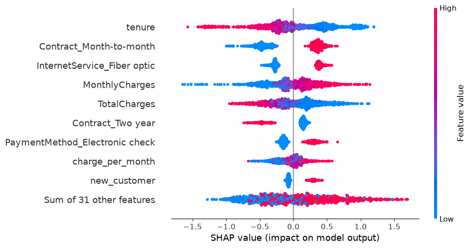
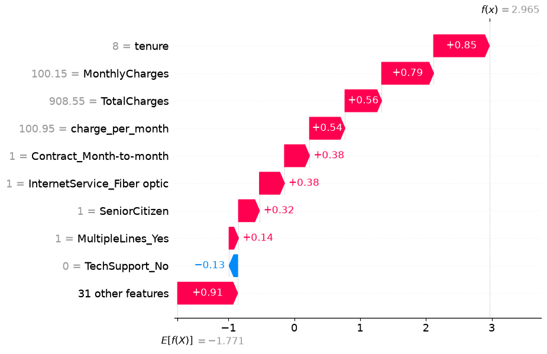
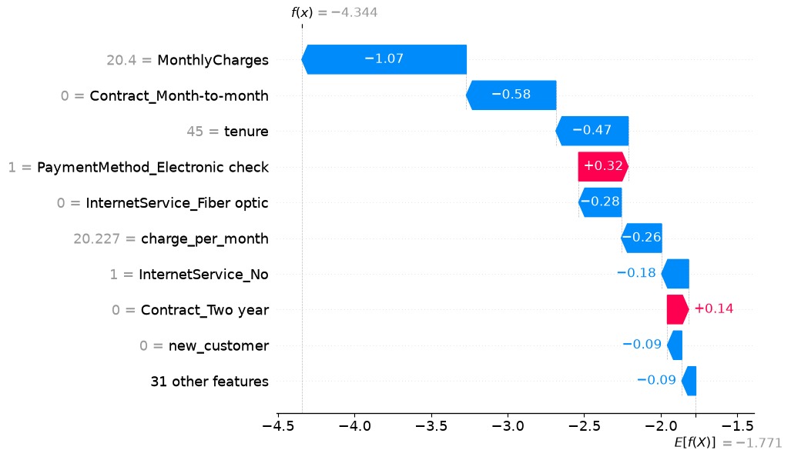
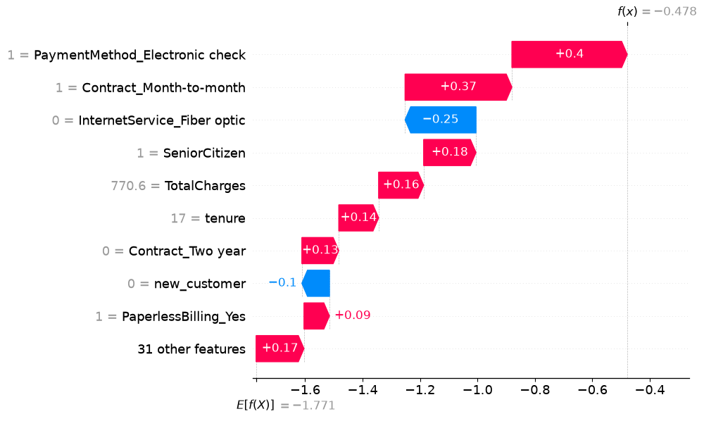

# Day 4: Boosting, features and explainability

## 1. Models compared (5-fold CV, PR-AUC)

| Model | PR-AUC |
| Logistic Regression (Day 3 best) | 0.662 ± 0.019 |
| CatBoost | 0.656 ± 0.024 |
| LightGBM | 0.643 ± 0.021 |

CatBoost was better than LightGBM, so I used CatBoost for the next steps.

## 2. New features

I made 4 features and tested each one on CatBoost (base score 0.656).

| Feature | What it is | Score | Result |
| charge_per_month | TotalCharges / tenure | 0.658 | keep |
| num_services | how many services the customer has | 0.654 | drop |
| new_customer | 1 if tenure is 6 months or less | 0.656 | keep |
| monthly_x_contract | MonthlyCharges if contract is month-to-month, else 0 | 0.655 | drop |

With both kept features together the score was 0.657. The change is very small (smaller than the std), so the new features almost didn't help. CatBoost already learns these patterns by itself.

## 3. Best model

| Model | PR-AUC |
| CatBoost + 2 features | 0.657 |
| Logistic Regression | 0.662 |

Logistic Regression was still the best, so it is saved in `models/best_model.joblib` with its config in `models/best_model_config.json` (C = 1.96, threshold = 0.16).

For SHAP I explained the CatBoost model, because Day 4 is about explaining a boosted model and the two scores are almost the same.

## 4. SHAP global explanation

Each dot is one test customer. Dots on the right push churn up, dots on the left push it down. Red means a high value, blue means a low value.

- **tenure** matters the most. New customers (blue) churn more, old customers (red) churn less.
- **Month-to-month contract** pushes churn predictions up a lot.
- **Fiber optic** internet pushes churn predictions up.
- **High monthly charges** push churn up.
- **Two year contract** pushes churn down a lot.
- **Electronic check** payment pushes churn up.

## 5. SHAP local explanations (CatBoost, threshold 0.12)

### False positive (test row 1, churn prob 0.95, customer stayed)

This customer had almost every risk sign: only 8 months tenure, a very high bill (100), month-to-month contract, fiber optic and senior citizen. So the model was very sure. But the customer stayed, maybe because they were happy with the service. This mistake is cheap, it only costs one offer.

### False negative (test row 61, churn prob 0.01, customer left)

This customer looked very safe: very low bill (20), 45 months tenure, not month-to-month and no internet service. Only electronic check pushed the risk up a little. They still left, so the reason was probably something that is not in our data, like moving or a better offer from another company.

### True positive (test row 9, churn prob 0.38, customer left)

Electronic check and month-to-month contract pushed the risk up. The probability was 0.38, which is above our threshold of 0.12, so the model caught this customer. With the default threshold of 0.5 this customer would have been missed.

## 6. Why customers churn (for the business)

Most customers leave are **new customers** who have low tenure  . Customers on a **month-to-month contract** leave much more than customers on a one or two year contract, because nothing keeps them. **High monthly bills** and **fiber optic** internet also go with more churn, so these customers may feel they are paying too much or are not happy with the service. Customers who pay by **electronic check** also leave more often than people who use automatic payments.

The customers who stay are the ones who have been with company for a **long time** and have a **two year contract**.

So the best customers to target with a retention offer are new, month-to-month customers with high monthly bills. Giving them a reason to move to a longer contract could help keep them.

Some customers leave for reasons we can't see in the data, so the model cannot predict every case.

## 7. Check yourself

**Why might impurity-based feature importance mislead you?**
It is calculated on the training data, so it can give importance to features the model only memorized. It also gives more importance to columns with many different values, like TotalCharges, even if they are not really more useful. Permutation importance on validation data can give a more useful picture of how much a feature actually helps predictions.

**When would you pick a simpler model over a slightly more accurate boosted one?**
When the performance difference is very small, the simpler model is easier to explain, faster and easier to maintain. In this case Logistic Regression (0.662) was better than CatBoost (0.657), so I selected Logistic Regression.